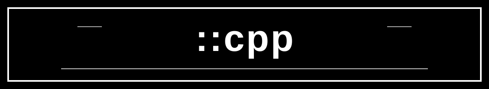

# Linux RAII D Modules for Real-World C++ Interop

This project is a DUB-based workspace for building practical, production-minded RAII abstractions in the D programming language, using the Phobos standard library as the foundational runtime and utilities layer.

The central goal is simple:

- write useful Linux-native abstractions in D
- model real operating-system resources with RAII semantics
- expose those abstractions as C++-friendly shared libraries
- package each abstraction as an independent sandbox project

Each sandbox under `source/<name>/` is meant to represent a focused, reusable D library that produces:

- a shared object (`.so`)
- a C++ header (`.hpp`)

This creates a workflow where a C++ developer can consume a D-built Linux library with a familiar header-based interface.

## Project philosophy

The goal is not toy examples. The goal is to engineer D modules that encapsulate real Linux resources and behaviors in a robust, idiomatic way.

Examples of the kinds of abstractions this workspace is intended to host:

- file handles and file-lock wrappers
- directory iteration utilities
- temporary and managed filesystem paths
- process and signal wrappers
- socket and network resource management
- memory-mapped file RAII types
- event-loop and polling wrappers
- thread and synchronization helpers
- cross-language bridge layers for C++ consumption

The emphasis is on correctness, deterministic cleanup, resource ownership, and a clear boundary between unsafe C-style primitives and safe D object lifetimes.

## Why D and Phobos

D gives us a strong combination of:

- modern systems programming ergonomics
- native performance
- expressive value semantics
- strong support for resource management
- clean interop with C and C++

Phobos provides the practical building blocks for:

- filesystem access
- string and text processing
- containers and algorithms
- concurrency primitives
- cross-platform system integration

The project keeps the focus on building real Linux RAII types, not on abstract compiler experiments.

## Repository layout

- `source/<name>/` — each sandbox library project
- `source/<name>/source/*.d` — D implementation files
- `source/<name>/dist/` — generated `.so` and `.hpp` outputs
- `source/<name>/test/main.cpp` — consuming C++ program
- `scripts/create-sandbox.sh` — generator for new sandbox modules

## Example sandbox

The `greeter` sandbox is included as a working example of this workflow.

Build and run it:

```bash
cd source/greeter
./test/run.sh
```

This example generates:

- `dist/libgreeter.so`
- `dist/greeter.hpp`

and then links the header to a small C++ consumer.

## Creating a new sandbox

Use the helper script:

```bash
./scripts/create-sandbox.sh <name>
```

Then run:

```bash
cd source/<name>
./test/run.sh
```

Each new sandbox follows the same pattern:

1. implement a Linux-oriented RAII abstraction in D
2. compile it with `ldc2` as a shared library
3. emit a matching C++ header
4. validate the result with a C++ test program

## Intended direction

This project is meant to become a growing library of useful, real-world RAII types for Linux systems programming, built in D and exposed cleanly to C++ engineering teams.

The long-term idea is to maintain a curated collection of well-structured modules, each focused on a single, practical resource-management problem, while keeping the generated `.so` + `.hpp` interface clean and reliable for C++ consumers.
